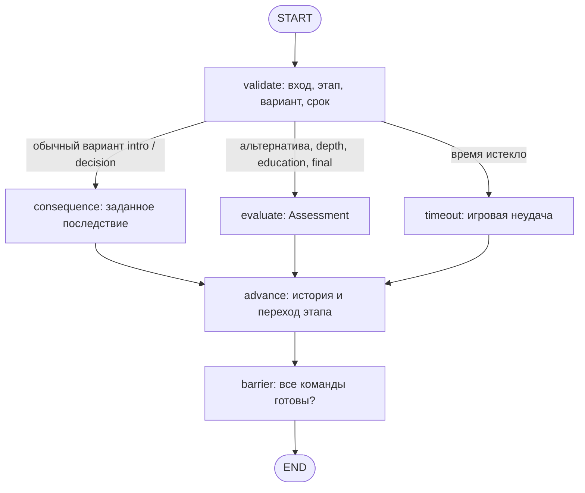

# Архитектура MVP

Основные точки входа — `play.py` для ведущего и `python -m game_agent.simulation` для CSV-прохождения. Оба пути используют один `GameService` и настоящий граф LangGraph из `game_agent/game.py`.

## Граф обработки одного ответа



Каждый вызов графа обрабатывает одну отправку. Граф не держит длительную открытую задачу ожидания игрока: результат сохраняется в SQLite, следующая отправка начинает новый вызов.

`validate` проверяет доступность этапа, ответ длиной 1–12000 символов и допустимый вариант выбора. На свободных этапах `choice_id` не принимается. Проверка времени использует часы сервиса; у CLI-симуляции часы управляемые.

`consequence` не вызывает LLM. Он берет последствие из каталога, устанавливает `provenance=authored_branch`; только при политике `author` вариант с `author_fail` дает `fail`. Здесь оценки пяти осей отсутствуют. `timeout` тоже обходится без модели и записывает `provenance=timer`.

`advance` сохраняет ответ и оценку, затем изменяет командный этап. `clarify` оставляет этап и не выдает новый полный срок; время успешного API-запроса исключается из отсчета. `fail` направляет команду на `education`; неудачный разбор снова оставляет ее на этом этапе с новым сроком. Успешный разбор или успешный `depth` переводит команду в `ready`. `barrier` открывает `final` только после готовности всех команд.

Общий финал принимает один свободный ответ. `clarify` оставляет финал открытым; `continue` или `fail` завершают игру и создают символические дипломы. Дополнительного восстановления после неудачи финала нет.

## Состояние и хранение

`GraphState` содержит снимок всей игры `session`, текущую команду `command`, выбранный `route`, `assessment` и запись ответа `record`.

| Данные | Основные поля |
| --- | --- |
| Игра | `id`, `version`, `participants`, `seed`, `policy`, `mode`, `timed`, `limits`, `phase` |
| Команда | `id`, `name`, `members`, `scenario_id`, `phase`, `started_at`, `choices`, `event` |
| История | ответ, вариант, этап, длительность, результат, обратная связь, происхождение оценки |
| Результат | готовность команд, `final_result`, `awards`, время завершения |

`SQLiteStore` сохраняет полный JSON-снимок в `game_sessions(id, version, state_json)`. Каждая операция открывает отдельное соединение. Чтение возвращает независимый снимок; изменение этого объекта не меняет базу до сохранения.

`GameService` загружает снимок, проверяет переданную версию, запускает граф и сохраняет результат через compare-and-swap: `UPDATE … WHERE id=? AND version=?`. Успешная запись увеличивает версию; конфликт вызывает `ConcurrentUpdate` и требует загрузить актуальную игру. Эта проверка предотвращает потерю изменений, но не является аутентификацией или разграничением прав.

Ключ API не входит в состояние игры. Путь базы настраивается через `GAME_DB_PATH` для интерфейса или `db_path` сервиса. При восстановлении сохраняется выбранный для игры `mode`; нужно использовать такой же режим сервиса.

## Оценщики и API

Интерфейс `Evaluator.evaluate(context: dict) -> Assessment` отделяет оценку от переходов игры. `create_evaluator()` по умолчанию создает `MockEvaluator`; `mode='openai'` создает `OpenAIEvaluator`, `mode='deepseek'` — `DeepSeekEvaluator`.

Контекст включает этап, сценарий, цель, вопрос, событие, ответ, историю, размер команды, политику и выбранный вариант. В общий финал передаются история и состояние всех команд, а также цели участвующих сценариев. Все содержимое этого контекста является недоверенными данными.

Реальный путь модели:

```mermaid
flowchart LR
    context[Контекст как JSON] --> prompt[ChatPromptTemplate]
    prompt --> model[ChatOpenAI через LCEL]
    model --> schema[Structured Assessment / Pydantic]
    schema --> graph[Переход игрового графа]
```

Системный промпт отделяет данные игрока от инструкций, просит краткое обоснование конкретного решения и запрещает оценивать личность или ставить диагнозы. Это граница инструкций, а не гарантия идеального поведения модели.

`Assessment` задает `outcome` из `continue/clarify/fail`, непустой `feedback`, `follow_up`, ровно пять целочисленных оценок 0–2, `reasons` и образовательный вывод. Уточнение обязательно содержит вопрос. JSON Schema оценок закрыта для посторонних ключей; Pydantic повторно проверяет результат.

Для OpenAI модель задается аргументом или `OPENAI_MODEL`, по умолчанию `gpt-4.1-mini`, ключ — аргументом или `OPENAI_API_KEY`. DeepSeek использует отдельные `DEEPSEEK_MODEL` (по умолчанию `deepseek-flash`) и `DEEPSEEK_API_KEY`. Отсутствие ключа выбранного провайдера выявляется до запроса, переключения на другого провайдера или демо не происходит. Настроены тайм-аут 45 секунд и одна повторная попытка. Живые API не проверены; ошибки не преобразуются в ложный успех или авторскую неудачу команды.

DeepSeek использует `ChatOpenAI` с фиксированным `base_url='https://api.deepseek.com'`, Chat Completions и `with_structured_output(Assessment, method='json_mode', include_raw=True)`. В system-сообщении явно переданы JSON Schema и пример; фигурные скобки JSON не интерполируются как переменные шаблона. `extra_body` задает `max_tokens=4096` и `thinking.type='disabled'`: лимит не передается как несовместимый `max_completion_tokens`. Необработанный JSON проверяется дополнительно, чтобы частично восстановленный парсером оборванный ответ не прошел в игру. `reasoning_content` не используется.

В состоянии игры `mode` хранит `mock`, `openai` или `deepseek`. Оцененные ответы сохраняют `provenance='openai'`/`'deepseek'`; заданные сюжетные последствия и таймер сохраняют прежние `authored_branch`/`timer`. Восстановление и продолжение разрешены с тем же провайдером; ключ не входит в снимок.

При исключении API состояние сохраняется без изменений. Поэтому время неуспешного запроса пока остается частью общего настенного времени этапа; для проверки живого API можно отключить игровые лимиты. Успешные запросы компенсируются при переходах и уточнениях.

Для замены модели достаточно реализовать тот же интерфейс оценщика или изменить фабрику. Новый транспорт, REST API или отдельный клиент должны обращаться к `GameService`, передавать ожидаемую версию снимка и отдельно реализовать аутентификацию, если она потребуется.

## Каталог и воспроизводимость

`data/author_text.json` в локальном архиве хранит извлеченный исходный текст и исключен из публичного Git вместе с исходными документами. Игровой каталог `data/game_catalog.json` содержит адаптированные вопросы, варианты, последствия, случайные события и разборы. `catalog.py` возвращает свежую копию каталога при каждом чтении.

Начальное распределение использует `seed`. Для выбора осложнения вычисляется SHA-256 от `seed`, ID команды и ветки выбора; локальный генератор выбирает событие из подходящего списка. Ветвь обращения к психологу не обязана возвращаться в магазин: для таких случаев в каталоге есть явно отмеченные расширения `source='mvp_extension'`.

В базу записывается уже выбранное событие. Восстановление игры не выбирает его заново. Версия каталога сейчас отдельно не закрепляется за игрой; обновление каталога во время незавершенной партии требует осторожности.
